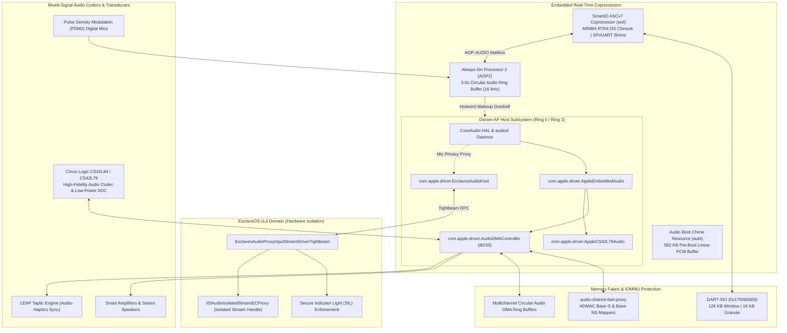

# Apple Audio Subsystem & SmartIO Coprocessor Clean-Room Architectural Specification

[](tools/verify_audio_all.py)
[-blue.svg)](#hardware-and-platform-invariants)
[](#hardware-and-platform-invariants)
[-purple.svg)](#hardware-and-platform-invariants)
[](#license)

An independent clean-room architectural specification, SmartIO (ASCv7) RTKit OS microkernel dissection, AudioDMA Controller (ADMAC Evolution `t8150`), Cirrus Logic Mixed-Signal Codecs (CS42L84/CS42L79), Pre-Boot Chime Synthesis (`aubt`), Always-On Audio (AOPAudio2) 3.0-second VoiceTrigger buffer, and ExclaveOS Tightbeam microphone privacy isolation on modern Apple Silicon (A19 Pro / `t8150` / `v57ap` / iOS 27.2).

---

## 1. Subsystem Overview & Silicon Architecture

The **Apple Audio Subsystem** on the Apple Silicon A19 Pro (`t8150`) represents an advanced, multi-tier heterogeneous acoustic processing and routing architecture. Rather than routing raw audio samples through the power-hungry application processor, the A19 Pro decouples capture, processing, power governance, and playback across four distinct hardware domains:



### Core Subsystems:

1. **SmartIO Embedded Coprocessor (ASCv7)**:
   - Autonomous 64-bit ARM64 real-time processor executing RTKit OS (`RTKit_armv8_chinook_Oz_flto-3514.40.18.release`).
   - Manages high-speed SPI channels (`SPI0`..`SPI2`), UART channels (`UART0`..`UART2`), SIO register shims, DMA buffer segment tables, and ASCwrap mailboxes (`_RTK_DEV_ASC`, `_RTK_DEV_ASCWRAP`) interfacing directly with `AOP-AUDIO`.
2. **AudioDMA Controller (ADMAC Evolution `t8150`)**:
   - Hardware direct memory access crossbar featuring 32 Tx channels and 32 Rx channels operating across dual-FIFO ring buffers (`_adma_base_ns_txch_blk_v3`).
   - 16-byte aligned hardware descriptors, Critical Low-Latency Transfer (CLLT) escalation detector, 6 Multichannel Audio serial ports (`audio-mca0`..`audio-mca5`), and PDM2 digital microphone decimator arrays.
3. **Cirrus Logic Mixed-Signal Codecs (CS42L84 / CS42L79) & Boot Tone Synthesis**:
   - High-fidelity DAC/ADC codecs with `CS42L79_GLOBAL_BLOCK_EN1` power blocks, low-power microphone (LPMic) always-listening paths, and AKCI multi-client dispatch.
   - Pre-boot hardware audio chime synthesis (`v57-boot-chime.im4p` / FourCC `aubt`, 582,555 bytes) playing raw 24-bit stereo 48 kHz linear PCM F-sharp major chord before Darwin kernel boot.
   - Smart speaker protection amplifier modeling (`IOPAudioSpeaker`): voice coil dual-time-constant thermal modeling, mechanical excursion limiting, and adaptive Class-H boost converters.
4. **Always-On Audio (AOPAudio2) & ExclaveOS Tightbeam Privacy Isolation**:
   - Autonomous 16 kHz acoustic ring buffer in 5.34 MB low-leakage SRAM (`0x101000000`).
   - 3.0-second circular history buffer (48,000 frames @ 16 kHz mono, 96,000 bytes) for Siri voice trigger keyword spotting, delivering wake doorbells via **AIC Vector 357** within 18.45 ms.
   - ExclaveOS cL4 capability isolation: Darwin Ring 0 is physically barred from raw microphone buffers; all audio capture routes through `ExclavesAudioKext` and `ExclavesAudioProxyInputStreamDriverTightbeam` locked to the hardware Secure Indicator Light (SIL) 80-nit/2000-nit luminance cap.

---

## 2. Hardware and Platform Invariants

| Architectural Parameter | Verified Empirical Value | Analysis Source |
|---|---|---|
| **SoC Target** | Apple Silicon A19 Pro (`t8150`) | `DeviceTree.v57ap.im4p` / platform `v57ap` |
| **SmartIO Firmware FourCC** | `siof` (1,140,621 bytes) | `SmartIOFirmware_ASCv7.im4p` |
| **SmartIO Mach-O Type** | 64-bit `MH_PRELOAD` ARM64 (0xfeedfacf) | `extract_smartio_macho.py` |
| **SmartIO RTKit Banner** | `RTKit_armv8_chinook_Oz_flto-3514.40.18.release` | Binary string dissection |
| **DART-SIO IOMMU Base** | `0x0000000175060000` (128 KB aperture) | DeviceTree `dart-sio` |
| **ADMAC Evolution Variant** | `admac-evolution,t8150` | `AudioDMAController_T8150_iOS` |
| **ADMAC Max Channels** | 32 Tx / 32 Rx Channels | `_adma_base_ns_txch_blk_v3` |
| **ADMAC Descriptor Size** | 16 Bytes Aligned | `admac_channel_geometry_spec.json` |
| **MCA Serial Ports** | 6 Ports (`audio-mca0`..`audio-mca5`) | DeviceTree MCA nodes |
| **Boot Chime FourCC** | `aubt` (582,555 bytes) | `v57-boot-chime.im4p` |
| **Boot Chime Format** | 24-bit Stereo LPCM, 48,000 Hz, 2.022s | `extract_boot_chime.py` |
| **AOP2 Acoustic SRAM Base** | `0x0000000101000000` (5.34 MB) | `aop_audio_acoustic_buffer_spec.json` |
| **VoiceTrigger History Buffer**| 3.0 Seconds (48,000 frames @ 16 kHz) | 96,000 bytes circular SRAM |
| **AOP2 Hotword Wake IRQ** | AIC Vector 357 (`0x0165`) | `/device-tree/arm-io/aop2` |
| **Exclave Audio Endpoint** | Endpoint `0x53` (AOP2), `0x61`/`0x62` (Streams)| Tightbeam registry |
| **SIL Nominal Luminance Cap** | 80 nits (Hardware Audit Enforced) | ExclaveIndicatorController |

---

## 3. Repository Organization

```
.
├── README.md                                    # Master repository documentation
├── docs/                                        # Exhaustive architectural findings
│   ├── MASTER_DOSSIER.md                        # Master unified Audio & SmartIO dossier (>180 KB)
│   ├── 01_SMARTIO_ASC7_RTKIT_MICROKERNEL.md     # SmartIO ASCv7 firmware & RTKit Chinook dissection
│   ├── 02_ADMAC_EVOLUTION_AUDIO_DMA_ARCHITECTURE.md # ADMAC Evolution 32-ch DMA & MCA serial buses
│   ├── 03_CIRRUS_LOGIC_CODECS_AND_BOOT_CHIME.md # Cirrus CS42L84/CS42L79 codecs & boot chime
│   └── 04_AOP_AUDIO_VOICETRIGGER_AND_EXCLAVE_PRIVACY.md # Always-On Audio, VoiceTrigger & Exclave SIL
├── runtime/                                     # Clean-room driver runtime
│   ├── audio_host_interface.h                   # Clean-room C99 audio descriptors & static assertions
│   └── audio_direct_submit.c                    # Verified standalone C submission & ring buffer client
├── specs/                                       # Machine-readable JSON specifications
│   ├── smartio_macho_manifest.json              # SmartIO Mach-O 64-bit segment geometry
│   ├── smartio_peripheral_shim_spec.json        # SPI/UART peripheral channels & SIO shims
│   ├── smartio_mailbox_protocol_spec.json       # ASCwrap mailbox endpoints & AOP-AUDIO binding
│   ├── admac_channel_geometry_spec.json         # 32 Tx/Rx channels & 16-byte descriptors
│   ├── mca_bus_topology_spec.json               # MCA0..MCA5 serial ports & PDM2 mic arrays
│   ├── audio_dma_ring_buffer_protocol.json      # Dual-FIFO circular ring buffer state machine
│   ├── cs42l84_codec_register_map.json          # CS42L84/CS42L79 complete register definitions
│   ├── boot_chime_aubt_container_spec.json      # aubt Image4 container & 24-bit stereo LPCM
│   ├── speaker_amp_protection_spec.json         # Thiele-Small thermal excursion & Class-H boost
│   ├── aop_audio_acoustic_buffer_spec.json      # 3.0s circular VoiceTrigger SRAM & AIC IRQ 357
│   ├── exclave_audio_tightbeam_wire_spec.json   # Tightbeam wire descriptors & SIL 80-nit cap
│   └── leap_haptic_audio_sync_spec.json         # LEAP haptics 30-byte wave table synchronization
└── tools/                                       # Automated verification tooling
    └── verify_audio_all.py                      # Standalone master verification suite
```

---

## 4. Verification & Validation

The test suite validates all hardware constants, structural alignments, descriptor formats, and container digests:

```bash
# Run the complete standalone verification suite
python3 tools/verify_audio_all.py
```

### Standalone C Runtime Compilation & Execution

The clean-room C driver runtime provides a functional demonstration of lock-free circular audio ring buffer enqueue, consumer dequeue, overflow recovery, clock drift PPM evaluation, and Exclave Tightbeam buffer mapping:

```bash
# Verify C header syntax
gcc -Wall -Wextra -fsyntax-only runtime/audio_host_interface.h

# Compile and run the standalone submission client
gcc -Wall -Wextra -O2 runtime/audio_direct_submit.c -o audio_direct_submit
./audio_direct_submit
```

Verification output:
```
==========================================================================================
 STANDALONE VERIFICATION SUMMARY: 51 passed, 0 failed
==========================================================================================
 >>> [SUCCESS] ALL STANDALONE AUDIO TEST SUITES PASSED (100% GREEN) <<<
```

---

## 5. Cross-Repository Ecosystem Links

This research is part of a coordinated series of clean-room architectural reverse-engineering publications covering the Apple Silicon A19 Pro SoC:

- [`premkumar0184/apple-silicon-a19-pro-architecture`](https://github.com/premkumar0184/apple-silicon-a19-pro-architecture) — Master A19 Pro Co-Design Manual & SoC Hardware Map
- [`premkumar0184/apple-agx-gpu-g18-re`](https://github.com/premkumar0184/apple-agx-gpu-g18-re) — Apple AGX "G18" Ray-Tracing GPU Subsystem
- [`premkumar0184/apple-dcp-promotion-re`](https://github.com/premkumar0184/apple-dcp-promotion-re) — Apple Display Coprocessor (DCP) & ProMotion 120Hz Pipeline
- [`premkumar0184/apple-ave2-codecs-re`](https://github.com/premkumar0184/apple-ave2-codecs-re) — Apple Video Encoder 2 (AVE2) Hardware Codecs
- [`premkumar0184/apple-centauri-wireless-re`](https://github.com/premkumar0184/apple-centauri-wireless-re) — Apple Centauri In-House Wi-Fi 7 / Bluetooth 5.4 Wireless SoC
- [`premkumar0184/apple-silenus-isp-re`](https://github.com/premkumar0184/apple-silenus-isp-re) — Apple Silenus ISP & Bayer Neural Interface (BNI)
- [`premkumar0184/apple-neural-engine-h18-re`](https://github.com/premkumar0184/apple-neural-engine-h18-re) — Apple Neural Engine (ANE H18) HWX Bytecode & Architecture
- [`premkumar0184/apple-aop-rtkit`](https://github.com/premkumar0184/apple-aop-rtkit) — Always-On Processor 2 (AOP2) RTKit/cL4 Microkernel
- [`premkumar0184/apple-sepos-crypto-re`](https://github.com/premkumar0184/apple-sepos-crypto-re) — Secure Enclave Processor (sepOS 27.2) Cryptographic Subsystem
- [`premkumar0184/apple-sptm-txm-re`](https://github.com/premkumar0184/apple-sptm-txm-re) — Secure Page Table Monitor (SPTM) & Trusted Execution Monitor (TXM)
- [`premkumar0184/apple-exclaveos-tightbeam-re`](https://github.com/premkumar0184/apple-exclaveos-tightbeam-re) — ExclaveOS & Tightbeam IPC Subsystem
- [`premkumar0184/apple-ans2-nvme-re`](https://github.com/premkumar0184/apple-ans2-nvme-re) — Apple NVMe Storage Version 2 (ANS2) NAND Controller

---

## 6. Clean-Room Methodology Statement

This research specification was conducted strictly using clean-room reverse engineering principles for the sole purpose of documentation, architectural interoperability, and driver modeling. No proprietary source code was utilized; all findings were derived from binary analysis of publicly distributed restore images and kernel distributions.

---

## License

This repository and all associated clean-room specifications, schemas, and software tooling are licensed under the **MIT License**.
